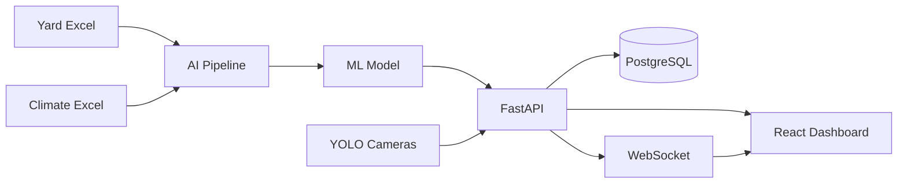

# Architecture technique — EUROGATE Risk Platform

## Vue d'ensemble

## Modules

| Module | Rôle |
|--------|------|
| `ai/pipeline` | Fusion, nettoyage, encoding, normalisation, labeling |
| `ai/training` | Entraînement RF / XGBoost / LightGBM |
| `ai/shap_explain` | Explicabilité des prédictions |
| `ai/yolo` | Détection visuelle des piles (bonus) |
| `backend` | REST + WebSocket + persistance |
| `frontend` | Dashboard opérationnel |
| `database` | Schéma PostgreSQL |

## Flux de risque

1. Ingestion Yard + Climat
2. Enrichissement & fusion temporelle
3. Calcul Risk Score (0–100) + Risk_Level
4. Entraînement / inférence ML
5. Génération d'alertes colorées + explication métier
6. Diffusion WebSocket vers le dashboard

## Coordonnées terminal (carte)

Approximation Tanger Med / EUROGATE : `35.895° N`, `-5.505° W`.
Les blocs yard sont projetés sur une grille Leaflet pour la heatmap.
